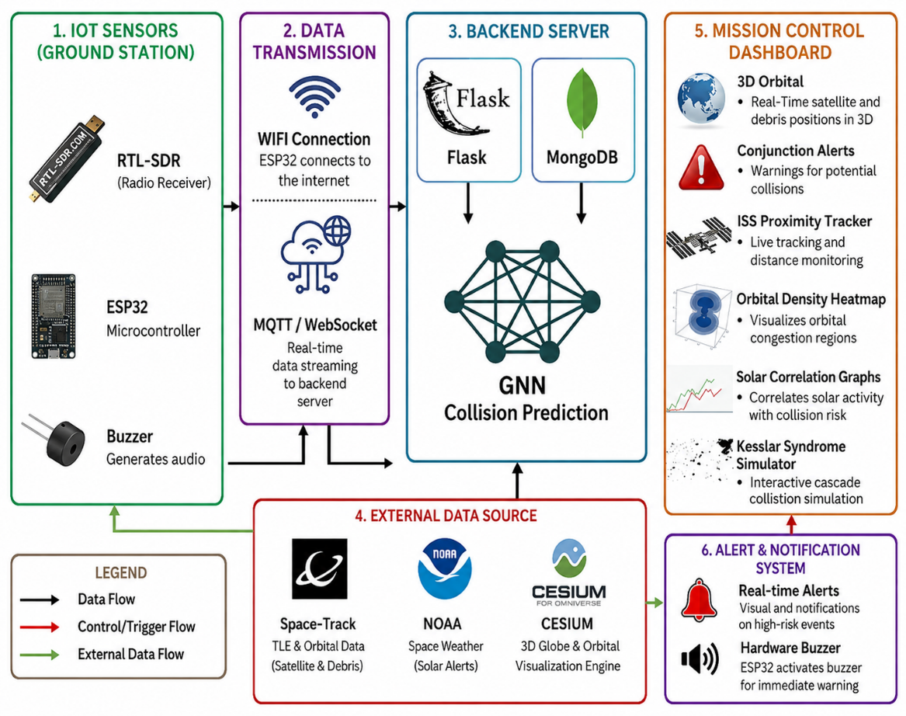
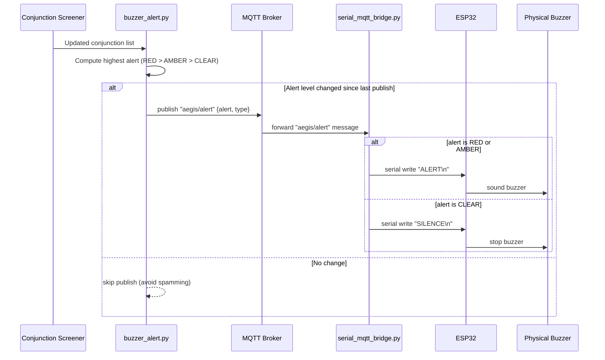
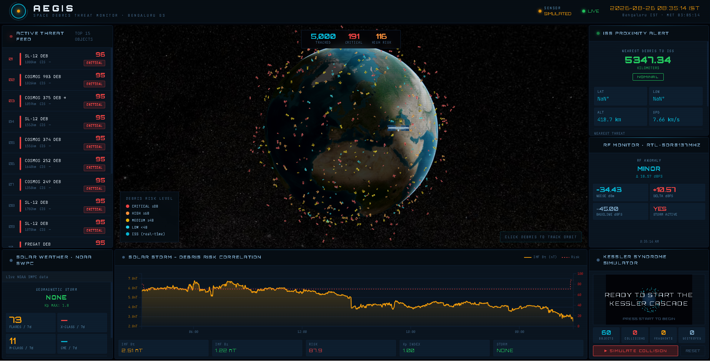
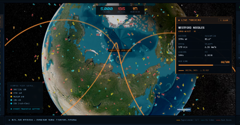
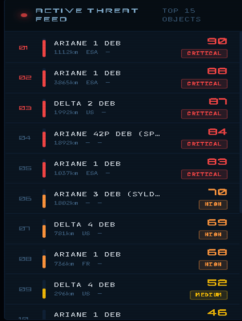
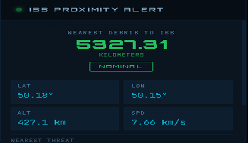
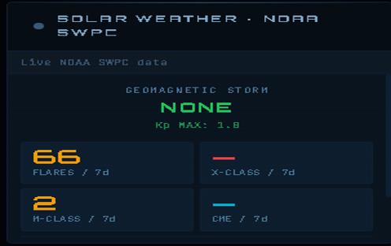
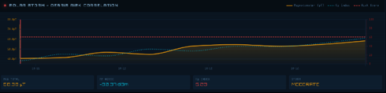
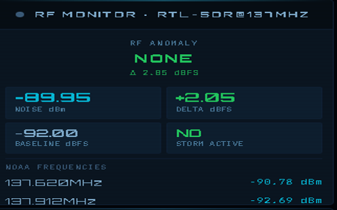
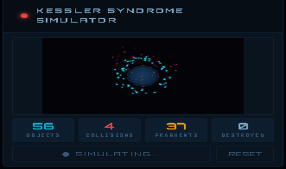

# AEGIS — Space Debris Threat Monitor

> Real-time orbital debris tracking, GNN-powered collision risk prediction, and solar weather correlation dashboard.

## Architecture

<!-- Add your architecture diagram here, e.g.:  -->


## Features

- **3D Globe** — CesiumJS visualization with 500+ debris objects color-coded by risk level
- **GNN Risk Scoring** — Graph Attention Network predicts cascade collision probability
- **ISS Protection** — Real-time proximity alerts (RED <5km, AMBER <10km, GREEN)
- **Conjunction Screening** — Debris×ISS and Debris×Debris close-approach prediction via SGP4
- **Solar Weather** — NOAA SWPC integration for geomagnetic storm and Kp index status
- **Hardware Alerting** — ESP32-driven physical buzzer + RTL-SDR RF monitoring via MQTT
- **Kessler Simulator** — Canvas-based cascade collision visualization

## Quick Start

### Prerequisites
- Python 3.12+
- Node.js 20+
- (Optional) MongoDB, Mosquitto MQTT broker

### Backend

```bash
cd backend
cp .env.example .env   # edit with your API keys
pip install -r requirements.txt
python app.py
```

Backend runs at `http://localhost:5000`

### Frontend

```bash
cd frontend
npm install
npm run dev
```

Frontend runs at `http://localhost:5173`

### Docker (all services)

```bash
docker compose up --build
```

This starts backend (5000), frontend (8080), and MongoDB (27017).

## API Endpoints

| Endpoint | Description |
|----------|-------------|
| `GET /api/health` | System health check |
| `GET /api/debris/list` | All debris objects with risk scores |
| `GET /api/debris/top-threats` | Top N highest-risk objects |
| `GET /api/debris/heatmap` | Altitude band density data |
| `GET /api/iss/position` | Live ISS position |
| `GET /api/iss/proximity` | Nearest debris to ISS |
| `GET /api/conjunction/upcoming` | Predicted close approaches (D×ISS + D×D) |
| `GET /api/conjunction/critical` | RED/AMBER conjunction events only |
| `GET /api/conjunction/stats` | Conjunction summary counts |
| `GET /api/solar/summary` | Solar weather summary |
| `GET /api/solar/correlation` | Sensor ↔ GNN correlation time-series |

## Configuration

Copy `backend/.env.example` to `backend/.env` and fill in:

| Variable | Source | Required |
|----------|--------|----------|
| `VITE_CESIUM_TOKEN` | [Cesium Ion](https://ion.cesium.com) | Yes |
| `SPACETRACK_USERNAME` | [Space-Track](https://www.space-track.org) | No (falls back to mock) |
| `SPACETRACK_PASSWORD` | Space-Track | No |
| `N2YO_API_KEY` | [N2YO](https://www.n2yo.com/api/) | No (falls back to mock) |
| `NASA_API_KEY` | [NASA](https://api.nasa.gov) | No (DEMO_KEY works) |
| `NOAA_SWPC_URL` | [NOAA SWPC](https://services.swpc.noaa.gov) | No |
| `USE_MOCK_SENSOR` | — | No (default: true) |

## Hardware Setup

When ready to use real hardware:

1. Flash ESP32 with `esp32_aegis/` Arduino code (buzzer alert only — no magnetometer is used in this build)
2. Connect RTL-SDR dongle and run `python backend/rtlsdr_monitor.py`
3. Start Mosquitto: `sudo systemctl start mosquitto`
4. Run the serial↔MQTT bridge: `python backend/serial_mqtt_bridge.py --port COM4` (adjust port)
5. Set `USE_MOCK_SENSOR=false` in `.env`
6. Restart backend

> Geomagnetic/solar data comes from NOAA SWPC (DSCOVR) directly — see `backend/services/noaa_swpc.py` — not from onboard hardware.

### Buzzer Alert Flow

The ESP32 stays serial-only over USB (its WiFi connection was unreliable), so alert state
reaches it through a bridge process rather than MQTT directly:



> **Note:** this diagram shows the *signal/data path* (screener → MQTT → serial → ESP32).
> It does not show the physical GPIO wiring (which pin the buzzer is on, driver
> transistor/resistor if any) — that lives in the ESP32 Arduino sketch under
> `esp32_aegis/`, which isn't in this repo yet.

## Training the GNN

```bash
cd backend
python -m backend.gnn.train
```

Model checkpoint saves to `gnn/aegis_gnn.pt`.

Diagnostic scripts (`backend/gnn/diagnose_training_data.py`, `inspect_cdm_fields.py`,
`trace_high_risk_ids.py`) help debug label coverage and CDM field issues if training
data looks off — see each script's docstring for what it checks.

## Screenshots

<p align="center">
  
  <br/><sub>Mission control overview — 3D globe with live debris field</sub>
</p>

<p align="center">
  
  <br/><sub>Object tracking — orbital path prediction for a selected debris object</sub>
</p>

<p align="center">
  
  <br/><sub>Active Threat Feed — top-ranked objects by GNN risk score</sub>
</p>

<p align="center">
  
  <br/><sub>ISS Proximity Alert</sub>
</p>

<p align="center">
  
  <br/><sub>Solar Weather — live NOAA SWPC feed</sub>
</p>

<p align="center">
  
  <br/><sub>Sensor ↔ Risk Score Correlation</sub>
</p>

<p align="center">
  
  <br/><sub>RF Monitor — RTL-SDR @ 137MHz</sub>
</p>

<p align="center">
  
  <br/><sub>Kessler Syndrome Simulator</sub>
</p>

## Project Structure

```
AEGIS/
├── backend/                       # Flask API + GNN + sensor
│   ├── app.py                     # Main entry point
│   ├── config.py                  # Environment configuration
│   ├── tasks.py                   # Background data pipelines
│   ├── mock_sensor.py             # Simulated sensor (default mode)
│   ├── rtlsdr_monitor.py          # RTL-SDR RF monitor
│   ├── serial_mqtt_bridge.py      # ESP32 serial <-> MQTT bridge
│   ├── buzzer_alert.py            # Publishes alert state for the buzzer
│   ├── gnn/                       # Graph Neural Network
│   │   ├── model.py               # GAT architecture
│   │   ├── train.py               # Training script
│   │   ├── train_kfold.py         # K-fold cross-validation
│   │   ├── diagnose_training_data.py
│   │   ├── inspect_cdm_fields.py
│   │   └── trace_high_risk_ids.py
│   ├── data/                      # SGP4 propagation, proximity, conjunction screening
│   ├── routes/                    # REST API blueprints (debris, iss, solar, conjunction)
│   ├── services/                  # External API clients (Space-Track, NOAA, N2YO, Mongo)
│   └── tests/                     # pytest suite
├── frontend/                      # React dashboard
│   ├── src/
│   │   ├── App.jsx                # Main layout (3-column grid)
│   │   ├── hooks/useAegis.jsx     # Central data hook
│   │   └── components/            # Dashboard panels
├── esp32_aegis/                   # Arduino firmware (TBD)
├── rtlsdr_diagnostic.py           # RTL-SDR hardware diagnostic tool
├── RTL_SDR_SETUP.md               # RTL-SDR hardware setup guide
├── aegis.mongodb.js               # MongoDB Playground queries
├── mosquitto.conf                 # MQTT broker config
├── docker-compose.yml             # Full stack orchestration
└── .gitignore
```

## License

MIT